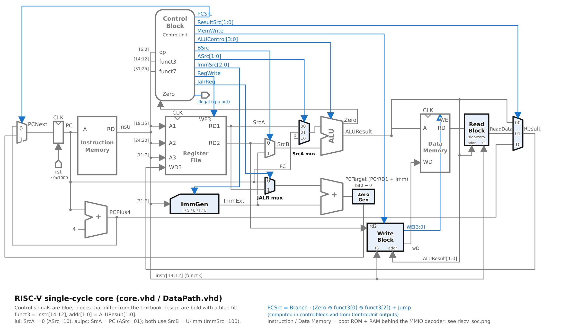

# RISC-V single-cycle CPU (VHDL)

Top level (`cpu.vhd`): core, boot ROM, RAM and the MMIO address decoder. Inputs: `clk`, `rst`, `irq`
(external interrupt, see [CSRs and interrupts](#csrs-and-interrupts)).


Inside the core (`core.vhd` / `DataPath.vhd`):



| Folder       | Content |
|--------------|---------|
| `rtl/`       | CPU source (`.vhd`) |
| `tb_ci_cd/`  | Automatic tests, one per block, run by CI |
| `tb_uni/`    | Testbenches for the university task (fibonacci program in `hex.hex`) |
| `docs/`      | Diagrams: top level `riscv_soc`, core datapath `riscv_datapath` (`.svg` + `.png`) |
| `quartus/`   | Quartus project |
| `outdated/`  | Old, unused files |

## Boot and memory map

On reset the PC is `0x0000_1000`, the start of the boot ROM (`bootrom.vhd`, loaded from `boot.hex`):

```
0x1000: 800002B7   lui  x5, 0x80000
0x1004: 00028067   jalr x0, 0(x5)      -> jump to RAM at 0x8000_0000
```

The program itself lives in the unified RAM (`unifiedmem.vhd`, loaded from `hex.hex`), which holds both
instructions and data. `cpu.vhd` opens `boot.hex` and `hex.hex` from the directory the simulation runs in.

`MMIO.vhd` decodes addresses:

| Region | Address range | Load data (`RDsel`) | Write enable |
|--------|---------------|---------------------|--------------|
| Boot ROM | `0x0000_1000`–`0x0000_1FFF` | `001` | none (read only) |
| CLINT | `0x0200_0000`–`0x0200_FFFF` | `100` | `We_4` |
| PLIC | `0x0C00_0000`–`0x0FFF_FFFF` | `011` | `We_3` |
| UART | `0x1000_0000`–`0x1000_00FF` | `010` | `WE3_2` (byte lanes) |
| GPIO | `0x1000_1000` | `101` | `We_5` |
| RAM | `0x8000_0000`– | `000` | `WE3M_1` (byte lanes) |

Anything else reads through `RDsel = 101` with no write enable. UART, PLIC, CLINT and GPIO are not connected
yet (their read data is 0 and their write enables are left open in `cpu.vhd`).

Instruction fetch: `interselmux` takes the boot ROM when the PC is in the ROM range, the RAM when
PC ≥ `0x8000_0000`, and `0x00000000` otherwise. Load data goes through `ReadDatamux`.

The RAM and ROM index with `address mod size`, so e.g. a store to the ROM range would hit a RAM word if
MMIO did not block it.

## CSRs and interrupts

`CSRblock.vhd` (inside `DataPath`) holds the machine-mode CSRs. Supported instructions: `csrrw`, `csrrs`,
`csrrc` (register operand only) and `mret`. `csrrs`/`csrrc` with `rs1 = x0` only read the CSR.
`csrrwi`/`csrrsi`/`csrrci`, `ecall`, `ebreak` are illegal.

| CSR | Address | Implemented bits |
|-----|---------|------------------|
| `mstatus` | `0x300` | bit 3 `MIE`, bit 7 `MPIE` |
| `mie` | `0x304` | bit 11 `MEIE` |
| `mtvec` | `0x305` | all 32 bits, direct mode only (the value is the handler address) |
| `mepc` | `0x341` | all 32 bits |
| `mcause` | `0x342` | all 32 bits, set to `0x8000_000B` on a trap |
| `mip` | `0x344` | bit 11 `MEIP` = the `irq` input, read only |

Any other CSR number reads 0 and ignores writes. Everything is 0 after reset.

The `irq` input of `cpu` / `core` is a level-sensitive external interrupt. When `irq`, `mstatus.MIE` and
`mie.MEIE` are all 1 (`controlblock`):

- the current instruction is cancelled (no register write, no store),
- `mepc` ← its PC, `mcause` ← `0x8000_000B`, `MPIE` ← `MIE`, `MIE` ← 0,
- PC ← `mtvec`.

`mret`: PC ← `mepc`, `MIE` ← `MPIE`, `MPIE` ← 1. The trap has priority over `mret`, branches and jumps.
There is no way to acknowledge the interrupt from software yet, so `irq` must be dropped by the source
before `mret` or the handler is entered again.

`Pc_mux` select (`PCsrc`): `00` PC+4, `01` branch/jump target, `10` `mtvec`, `11` `mepc`.
`result_mux` (`Result_Src`): `00` ALU, `01` load data, `10` PC+4, `11` CSR old value.

## Run the tests

```sh
./tb_ci_cd/run.sh          # all block tests, prints PASS/FAIL per test, exit code 1 on failure
```

Needs `ghdl` (VHDL-2008). A new test = a new `tb_ci_cd/<name>_tb.vhd` file, it is picked up automatically.
A new RTL file must be added to the `RTL=` list in `run.sh` (in dependency order) and to `ci.yml`.

Fibonacci program on the whole CPU (the university task), expects fib(20) = 6765 in a0:

```sh
cd tb_uni
for f in ControlUnit ImmGen PCPlus4 PCTarget MuxJalr ZeroGen Pc_mux alu alu_mux SrcAMux result_mux pc riscvregfile controlblock CSRblock DataPath WriteBlock ReadBlock core unifiedmem bootrom MMIO interselmux ReadDatamux cpu; do ghdl -a --std=08 ../rtl/$f.vhd; done
ghdl -a --std=08 cpu_fib_tb.vhd && ghdl --elab-run --std=08 cpu_fib_tb --assert-level=error
```

## What is tested (`tb_ci_cd`)

| Test | Covers |
|------|--------|
| `alu_tb` | every ALU operation, 65k random operand pairs, zero flag |
| `controlunit_tb` | **all** 131 072 opcode/funct3/funct7 combinations vs. a reference table (for SYSTEM also `rs1` = 0/1/31): CSR decode, `mret`, illegal SYSTEM instructions must not write |
| `controlblock_tb` | PCsrc for every opcode/funct3/zero, example instructions, CSR/`mret` decode, trap for all 8 `irq`/`MIE`/`MEIE` combinations, trap cancels register/memory writes and wins over jumps, branches and `mret` |
| `csrblock_tb` | `CSRblock`: reset values, `csrrw`/`csrrs`/`csrrc` on every CSR and its writable bits, `mip` follows `irq` and is read only, unknown CSR, trap and `mret` state changes, trap priority over `mret` and CSR writes |
| `immgen_tb` | I, S, B, J and U immediates for 20k random instructions |
| `riscvregfile_tb` | 5000 random writes/reads vs. model, x0 hard-wired to 0, write enable |
| `readblock_tb` | exhaustive funct3 × address offset: lb/lh/lw/lbu/lhu selection, sign/zero extension, misaligned → 0 |
| `writeblock_tb` | exhaustive MemWrite × funct3 × offset: sb/sh/sw byte enables and data lanes, misaligned → no write |
| `small_blocks_tb` | `pc` (reset to `0x1000`), `PCPlus4`, `PCTarget`, `Pc_mux` (all 4 inputs), `alu_mux`, `SrcAMux` |
| `datapath_tb` | datapath with hand-driven control signals, including CSR read/write through the register file, trap to `mtvec` and `mret` to `mepc` |
| `core_tb` | ~1000-instruction random program at `0x1000` (R, I, loads, stores, beq/bne, jal/jalr, lui/auipc) vs. an RV32I software model: PC, ALU result, registers, store byte enables/data every cycle (`irq` = 0) |
| `core_irq_tb` | `core` with a small program: sets `mtvec`/`mie`/`mstatus`, loops; `irq` is ignored until enabled, then traps to the handler, cancels the interrupted instruction, is not re-entered while `MIE` = 0, handler reads `mcause`/`mepc`, `mret` returns, a second interrupt works |
| `bootrom_tb` | `boot.hex` at `0x1000` (`lui x5,0x80000` ; `jalr x0,0(x5)`) on the instruction and data ports, wraparound |
| `unifiedmem_tb` | file loading, PC wraparound, every byte-enable combination, data writes visible on the instruction port |
| `mmio_tb` | `MMIO` decode of every region and its edges, write enables, `interselmux` and `ReadDatamux` selection |
| `cpu_boot_tb` | whole `cpu`: boot `0x1000` → `0x1004` → `0x8000_0000`, then `hex.hex`: ROM read via `lw`, RAM store/load, store to ROM is dropped, `auipc` in RAM, halt |

`cpu_boot_tb`, `cpu_fib_tb` and `core_irq_tb` read the PC and register writes through VHDL-2008 external names
(`<<signal .tb.dut.... >>`), since `cpu` only exposes `RezOUT` and `Illegal`.

CI (`.github/workflows/ci.yml`) runs `tb_ci_cd/run.sh` and the fibonacci test on every push / pull request.
