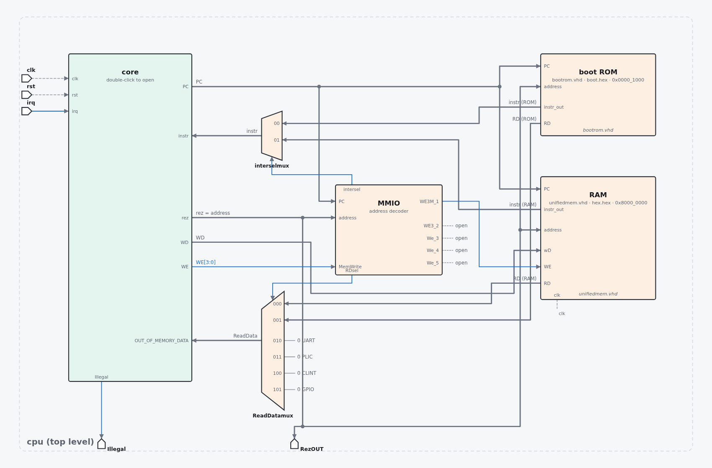
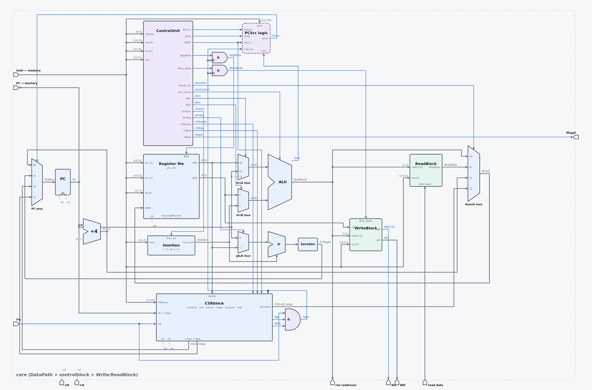

# RISC-V single-cycle CPU (VHDL)

RV32I (without `fence`, `ecall`, `ebreak`) plus machine-mode CSRs, `mret` and one external interrupt.
Every instruction finishes in one clock cycle.

Top level (`cpu.vhd`): core, boot ROM, RAM and the MMIO address decoder.

| Port | Dir | Meaning |
|------|-----|---------|
| `clk` | in | clock, everything is rising-edge |
| `rst` | in | synchronous reset: PC ← `0x0000_1000`, CSRs ← 0 |
| `irq` | in | external interrupt, level-sensitive (see [CSRs and interrupts](#csrs-and-interrupts)) |
| `Illegal` | out | 1 while the current instruction is not supported (it is executed as a no-op, nothing traps) |
| `RezOUT` | out | ALU result of the current instruction (= data address for loads/stores) |

## Interactive schematic: [`docs/cpu.html`](docs/cpu.html)

One self-contained page (no dependencies) with every RTL block and every wire, in two levels: `cpu` (top level)
and `core` (DataPath, controlblock and Write/ReadBlock flattened into one schematic). Open it in a browser from a
clone (`xdg-open docs/cpu.html`); GitHub shows only its source.

- **Decode an instruction**: type `lw x5, 8(x2)` or a hex word. The page decodes it with a copy of
  `ControlUnit`, writes the control values on the wires, and highlights only the paths that carry it
  (mux inputs that are not selected stay dim). Toggles for branch taken, `irq`/`MIE`/`MEIE`, and the PC / data
  address region (MMIO selects in the `cpu` view).
- **Walkthroughs**: boot, every instruction class, CSR access, interrupt trap, `mret`, illegal instruction,
  step by step with an explanation (`←` `→`, ▶ to play).
- **Click a block**: entity, file, ports with the signal on each, select encodings, the tests that cover it.
  Click a wire: driver and destinations. Double-click `core` to open it. `/` searches blocks and signals.
- **Links**: the URL keeps the state, e.g. `cpu.html#view=core&asm=beq%20x1,x2,-8&ctx=taken&sel=pcsrc`.
- **SVG ↓** downloads the current view.

| Top level (`cpu.vhd`) | Core (`core.vhd`, flattened) |
|---|---|
|  |  |

The drawing is data (the JSON model at the top of `cpu.html`), and `tb_ci_cd/check_docs.sh` checks it against
the RTL in CI:
- every entity has exactly the ports of its `rtl/*.vhd` (name, direction, width),
- every drawn wire connects pins that are on one RTL net, and every connection in the RTL is drawn (the RTL is
  flattened through `DataPath` / `controlblock`; the logic assignments in `controlblock.vhd` are drawn as the
  gate blocks),
- the page's JS decoder gives the same outputs as `ControlUnit.vhd` for all 131 072 opcode / funct3 / funct7
  combinations (+ `rs1` = 0 / 1 for SYSTEM), using a GHDL dump (`tb_ci_cd/controlunit_dump.vhd`).

So a change in the RTL that is not reflected in the page fails CI. To update the drawing, edit the model:
blocks have coordinates and pins per side, wires are routed with `x:` / `y:` moves (see the comment above the
model). Preview images: `chromium --headless --screenshot --window-size=2700,1780 "file://$PWD/docs/cpu.html#view=core&bare&theme=light"`.

| Folder       | Content |
|--------------|---------|
| `rtl/`       | CPU source (`.vhd`), one entity per file |
| `tb_ci_cd/`  | Automatic tests, one per block, run by CI |
| `tb_uni/`    | Testbenches for the university task (fibonacci program in `hex.hex`) |
| `docs/`      | Interactive schematic `cpu.html` + preview images |
| `quartus/`   | Quartus project |
| `outdated/`  | Old, unused files |

## Supported instructions

| Type | Instructions |
|------|--------------|
| R | `add sub sll slt sltu xor srl sra or and` |
| I (ALU) | `addi slti sltiu xori ori andi slli srli srai` |
| Load | `lb lh lw lbu lhu` (misaligned `lh`/`lhu`/`lw` read 0) |
| Store | `sb sh sw` (misaligned `sh`/`sw` write nothing) |
| Branch | `beq bne blt bge bltu bgeu` |
| Jump | `jal jalr` |
| U | `lui auipc` |
| SYSTEM | `csrrw csrrs csrrc mret` |

Anything else (`fence`, `ecall`, `ebreak`, `csrr*i`, unknown opcodes / funct3 / funct7) raises `Illegal` and
writes nothing.

## Block reference

Hierarchy:

```
cpu
├── core
│   ├── DataPath
│   │   ├── pc, PCPlus4, MuxJalr, PCTarget, ZeroGen, Pc_mux      (next PC)
│   │   ├── riscvregfile, ImmGen, SrcAMux, alu_mux, alu          (execute)
│   │   ├── CSRblock                                             (CSRs, trap state)
│   │   └── result_mux                                           (register write-back)
│   ├── controlblock
│   │   └── ControlUnit
│   ├── WriteBlock
│   └── ReadBlock
├── bootrom
├── unifiedmem
├── MMIO
├── interselmux
└── ReadDatamux
```

### Core (`core.vhd`)

| Block | File | What it does |
|-------|------|--------------|
| `core` | `core.vhd` | Wires `DataPath`, `controlblock`, `WriteBlock`, `ReadBlock`. Talks to memory through `PC`/`instr` (fetch) and `rez`/`WD`/`WE`/`OUT_OF_MEMORY_DATA` (data). |
| `DataPath` | `DataPath.vhd` | All 32-bit datapath blocks below. Store data `WD` = RD2, data address `REZ` = ALU result. |
| `controlblock` | `controlblock.vhd` | `ControlUnit` + `PCsrc` selection + trap: `TRAP = irq · MIE · MEIE`; `TRAP` forces `RegWrite` and `MemWrite` to 0. |
| `ControlUnit` | `ControlUnit.vhd` | Combinational decoder of `opcode`, `funct3`, `funct7` (and `rs1` for `csrrs`/`csrrc`), see [Control signals](#control-signals). |
| `WriteBlock` | `WriteBlock.vhd` | Store formatting: byte enables `WE[3:0]` from `funct3` and `addr[1:0]`, replicates the byte / half into all lanes of `wD`. Misaligned → `WE = 0000`. |
| `ReadBlock` | `ReadBlock.vhd` | Load formatting: picks byte / half / word at `addr[1:0]`, sign- or zero-extends by `funct3`. Misaligned half / word → 0. |

### Datapath (`DataPath.vhd`)

| Block | File | What it does |
|-------|------|--------------|
| `pc` | `pc.vhd` | PC register, reset value `0x0000_1000` (boot ROM). |
| `PCPlus4` | `PCPlus4.vhd` | PC + 4. |
| `MuxJalr` | `MuxJalr.vhd` | Base of the jump target: PC (`JalrReg = 0`, branches / `jal`) or RD1 (`JalrReg = 1`, `jalr`). |
| `PCTarget` | `PCTarget.vhd` | base + ImmExt. |
| `ZeroGen` | `ZeroGen.vhd` | Clears bit 0 of the target (needed by `jalr`, harmless for the rest). |
| `Pc_mux` | `Pc_mux.vhd` | Next PC (`PCsrc`): `00` PC+4, `01` jump/branch target, `10` `mtvec` (trap), `11` `mepc` (`mret`). |
| `riscvregfile` | `riscvregfile.vhd` | 32 × 32-bit registers, 2 asynchronous reads, 1 write on the clock edge, `x0` always 0. |
| `ImmGen` | `ImmGen.vhd` | Immediate (`ImmSrc`): `000` I, `001` S, `010` B, `011` J, `100` U. |
| `SrcAMux` | `SrcAMux.vhd` | ALU input A (`ASrc`): `00` RD1, `01` PC (`auipc`), `10` 0 (`lui`). |
| `alu_mux` | `alu_mux.vhd` | ALU input B (`BSrc`): `0` RD2, `1` ImmExt. |
| `alu` | `alu.vhd` | See ALU codes below; `Z` = result is 0. |
| `CSRblock` | `CSRblock.vhd` | Machine CSRs, trap entry and `mret`, see [CSRs and interrupts](#csrs-and-interrupts). Write data = RD1, CSR number = `instr[31:20]`, outputs the old CSR value, `mtvec`, `mepc`, `MIE`, `MEIE`. |
| `result_mux` | `result_mux.vhd` | Register write data (`Result_Src`): `00` ALU result, `01` load data, `10` PC+4 (`jal`/`jalr`), `11` old CSR value. |

ALU codes (`alu_control`):

| Code | Op | Code | Op |
|------|----|------|----|
| `0000` | add | `0101` | srl |
| `1000` | sub | `1101` | sra |
| `0001` | sll | `0100` | xor |
| `0010` | slt (signed) | `0110` | or |
| `0011` | sltu | `0111` | and |

Shift amount is `B[4:0]`. Unknown codes give 0.

### Top level (`cpu.vhd`)

| Block | File | What it does |
|-------|------|--------------|
| `bootrom` | `bootrom.vhd` | 64-word ROM loaded from `boot.hex`. Two asynchronous read ports: instruction (by `PC`) and data (by address). |
| `unifiedmem` | `unifiedmem.vhd` | 128-word RAM loaded from `hex.hex`, holds code and data. Asynchronous instruction and data reads, byte-enable write on the clock edge. |
| `MMIO` | `MMIO.vhd` | Address decoder: `intersel` (which memory feeds the instruction), `RDsel` (which source feeds load data) and the per-region write enables, see the memory map. |
| `interselmux` | `interselmux.vhd` | Instruction source: `00` boot ROM, `01` RAM, else `0x0000_0000`. |
| `ReadDatamux` | `ReadDatamux.vhd` | Load data source: `000` RAM, `001` ROM, `010` UART, `011` PLIC, `100` CLINT, `101` GPIO, else 0. |

## Control signals

Produced by `ControlUnit` (`PCsrc` and the `TRAP` masking by `controlblock`). Blank = 0.

| Instruction | RegWrite | ImmSrc | ASrc | BSrc | ALU | MemWrite | ResultSrc | Branch | Jump | JalrReg | CSR |
|-------------|:-:|:-:|:-:|:-:|:-:|:-:|:-:|:-:|:-:|:-:|:-:|
| R-type | 1 | | `00` | 0 | by funct3/7 | | `00` | | | | |
| I-type ALU | 1 | `000` | `00` | 1 | by funct3/7 | | `00` | | | | |
| load | 1 | `000` | `00` | 1 | add | | `01` | | | | |
| store | | `001` | `00` | 1 | add | 1 | | | | | |
| `beq`/`bne` | | `010` | `00` | 0 | sub | | | 1 | | | |
| `blt`/`bge` | | `010` | `00` | 0 | slt | | | 1 | | | |
| `bltu`/`bgeu` | | `010` | `00` | 0 | sltu | | | 1 | | | |
| `jal` | 1 | `011` | | | | | `10` | | 1 | | |
| `jalr` | 1 | `000` | | | | | `10` | | 1 | 1 | |
| `lui` | 1 | `100` | `10` | 1 | add | | `00` | | | | |
| `auipc` | 1 | `100` | `01` | 1 | add | | `00` | | | | |
| `csrrw` | 1 | | | | | | `11` | | | | write, op `01` |
| `csrrs` | 1 | | | | | | `11` | | | | op `10`, write if `rs1 ≠ x0` |
| `csrrc` | 1 | | | | | | `11` | | | | op `11`, write if `rs1 ≠ x0` |
| `mret` | | | | | | | | | | | `MRET` = 1 |

Branch taken when `Zero ⊕ funct3[0] ⊕ funct3[2]` = 1 (`beq` on equal, `bne` on not equal, `blt`/`bltu` when
`slt` = 1, `bge`/`bgeu` when `slt` = 0).

`PCsrc` priority (`controlblock`): `10` if `TRAP`, else `11` if `MRET`, else `01` if taken branch or jump,
else `00`.

## Boot and memory map

On reset the PC is `0x0000_1000`, the start of the boot ROM (`bootrom.vhd`, loaded from `boot.hex`):

```
0x1000: 800002B7   lui  x5, 0x80000
0x1004: 00028067   jalr x0, 0(x5)      -> jump to RAM at 0x8000_0000
```

The program itself lives in the unified RAM (`unifiedmem.vhd`, loaded from `hex.hex`), which holds both
instructions and data. `cpu.vhd` opens `boot.hex` and `hex.hex` from the directory the simulation runs in.

`MMIO.vhd` decodes addresses:

| Region | Address range | Load data (`RDsel`) | Write enable |
|--------|---------------|---------------------|--------------|
| Boot ROM | `0x0000_1000`–`0x0000_1FFF` | `001` | none (read only) |
| CLINT | `0x0200_0000`–`0x0200_FFFF` | `100` | `We_4` |
| PLIC | `0x0C00_0000`–`0x0FFF_FFFF` | `011` | `We_3` |
| UART | `0x1000_0000`–`0x1000_00FF` | `010` | `WE3_2` (byte lanes) |
| GPIO | `0x1000_1000` | `101` | `We_5` |
| RAM | `0x8000_0000`– | `000` | `WE3M_1` (byte lanes) |

Anything else reads through `RDsel = 101` with no write enable. UART, PLIC, CLINT and GPIO are not connected
yet (their read data is 0 and their write enables are left open in `cpu.vhd`).

Instruction fetch: `interselmux` takes the boot ROM when the PC is in the ROM range, the RAM when
PC ≥ `0x8000_0000`, and `0x00000000` otherwise. Load data goes through `ReadDatamux`.

The RAM and ROM index with `address mod size`, so e.g. a store to the ROM range would hit a RAM word if
MMIO did not block it.

## CSRs and interrupts

`CSRblock.vhd` (inside `DataPath`) holds the machine-mode CSRs. Supported instructions: `csrrw`, `csrrs`,
`csrrc` (register operand only) and `mret`. `csrrs`/`csrrc` with `rs1 = x0` only read the CSR.
`csrrwi`/`csrrsi`/`csrrci`, `ecall`, `ebreak` are illegal.

| CSR | Address | Implemented bits |
|-----|---------|------------------|
| `mstatus` | `0x300` | bit 3 `MIE`, bit 7 `MPIE` |
| `mie` | `0x304` | bit 11 `MEIE` |
| `mtvec` | `0x305` | all 32 bits, direct mode only (the value is the handler address) |
| `mepc` | `0x341` | all 32 bits |
| `mcause` | `0x342` | all 32 bits, set to `0x8000_000B` on a trap |
| `mip` | `0x344` | bit 11 `MEIP` = the `irq` input, read only |

Any other CSR number reads 0 and ignores writes. Everything is 0 after reset.

The `irq` input of `cpu` / `core` is a level-sensitive external interrupt. When `irq`, `mstatus.MIE` and
`mie.MEIE` are all 1 (`controlblock`):

- the current instruction is cancelled (no register write, no store),
- `mepc` ← its PC, `mcause` ← `0x8000_000B`, `MPIE` ← `MIE`, `MIE` ← 0,
- PC ← `mtvec`.

`mret`: PC ← `mepc`, `MIE` ← `MPIE`, `MPIE` ← 1. The trap has priority over `mret`, branches and jumps.
There is no way to acknowledge the interrupt from software yet, so `irq` must be dropped by the source
before `mret` or the handler is entered again.

## Run the tests

```sh
./tb_ci_cd/run.sh                  # everything: PASS/FAIL per run, exit code 1 on any failure
./tb_ci_cd/run.sh alu_tb core_tb   # only these testbenches
SEEDS="1 2 3 4 5" ./tb_ci_cd/run.sh   # more seeds for the random tests (default 1 2 3)
```

Needs `ghdl`, and `node` for the docs check (skipped without it). What `run.sh` does:

1. Analyzes `rtl/*.vhd` with `--std=93c`: the Quartus project has no `VHDL_INPUT_VERSION`, so Quartus compiles the
   RTL as VHDL-93, and VHDL-2008-only code in `rtl/` must fail here, not in Quartus.
2. Analyzes everything as VHDL-2008 (the testbenches need it) and runs every `tb_ci_cd/*_tb.vhd`, once per seed
   if the testbench has a `G_SEED` generic.
3. A run is PASS only if the exit code is 0, the testbench printed `TEST PASSED` and there is no `[ERROR]` line.
   A crash, a hang (wall-clock limit `WALL`, default 300 s) or a testbench that stops early has no marker and fails.

The testbenches use `tb_ci_cd/tb_pkg.vhd` (checks, logging, watchdog, `tb_finish`, seeded random, scoreboard) and
`tb_ci_cd/riscv_ref_pkg.vhd` (reference decode / ALU / immediates written from the tables in this README). Each one:

- states its verification plan in the header (features from this README → how they are checked),
- computes the expected values from the spec with its own model, not by copying the RTL,
- has a watchdog, ends itself with `tb_finish`, and counts coverage of the corners it is meant to hit,
- deliberately injects at least one wrong prediction (`[XERR ]` lines, "injected errors caught") to prove its
  checks can fail.

A new test = a new `tb_ci_cd/<name>_tb.vhd` (entity name = file name) built the same way; it is picked up
automatically. A new RTL file must be added to the `RTL=` list in `run.sh` (in dependency order) and to `ci.yml`,
and drawn in `docs/cpu.html` (the docs check says what is missing).

Fibonacci program on the whole CPU (the university task), expects fib(20) = 6765 in a0:

```sh
cd tb_uni
for f in ControlUnit ImmGen PCPlus4 PCTarget MuxJalr ZeroGen Pc_mux alu alu_mux SrcAMux result_mux pc riscvregfile controlblock CSRblock DataPath WriteBlock ReadBlock core unifiedmem bootrom MMIO interselmux ReadDatamux cpu; do ghdl -a --std=08 ../rtl/$f.vhd; done
ghdl -a --std=08 cpu_fib_tb.vhd && ghdl --elab-run --std=08 cpu_fib_tb --assert-level=error
```

## What is tested (`tb_ci_cd`)

| Test | Covers |
|------|--------|
| `alu_tb` | every code incl. the 6 unused ones, corner operands (0, ±1, min/max, `AA..`/`55..`, shift amounts 0/1/31 with garbage in `B[31:5]`) × all codes, 20k random; bit-level reference model; zero flag; coverage of carry, borrow, signed≠unsigned compare, `sra` of negatives |
| `immgen_tb` | I/S/B/J/U: the test encodes a chosen immediate (range ends, powers of two, random) into an instruction with random other fields and expects it back |
| `small_blocks_tb` | `pc` (sync reset to `0x1000` with all-ones on `PCNext`, reset mid-run), `PCPlus4`, `PCTarget`, `ZeroGen`, `MuxJalr`, `Pc_mux`, `alu_mux`, `SrcAMux`, `result_mux`: every select with distinct random inputs |
| `readblock_tb` | every funct3 × offset × directed + random words: lb/lh/lw/lbu/lhu, sign/zero extension, misaligned → 0 |
| `writeblock_tb` | every MemWrite × funct3 × offset × directed + random data: byte enables, lane data, misaligned → no write |
| `riscvregfile_tb` | all registers, x0 hard-wired, write enable, old value until the edge, both ports, 5000 random writes/reads vs. a shadow model |
| `bootrom_tb` | `boot.hex` loaded by the test itself + the two boot instructions from this README, both ports addressed differently, wraparound, byte offsets, random addresses |
| `unifiedmem_tb` | file contents on both ports, every byte-enable combination, old value until the edge, data write visible on the instruction port, random writes/reads vs. a shadow model |
| `mmio_tb` | every region at base−1 / base / end / end+1 × all 16 `MemWrite` values, random addresses near region edges, instruction source, every select code of `interselmux` and `ReadDatamux` |
| `controlunit_tb` | **all** 131 072 opcode/funct3/funct7 combinations (SYSTEM also `rs1` = 0/1/31, others random `rs1`) vs. the control table above: every field of legal instructions; illegal ones must not write, branch or jump |
| `controlblock_tb` | every opcode × funct3 × zero × `irq`/`MIE`/`MEIE`, 20k random instructions: decode passes through, branch decision per instruction, PCsrc priority, `TRAP`, trap cancels register/memory writes |
| `csrblock_tb` | reset with all inputs active, write/set/clear on every CSR and unknown ones, `mip` read only, trap/`mret` state, trap wins over `mret` and CSR writes, 20k random cycles vs. a CSR model, reset mid-run |
| `datapath_tb` | `DataPath` with 20k cycles of random control signals vs. a model built from the block table: ALU inputs, immediates, write-back sources, next-PC sources, CSRs, trap/`mret`, reset mid-run |
| `core_tb` | ~900-instruction random program per seed vs. an RV32I instruction model: all R/I ops, all loads/stores incl. misaligned, all six branches (taken and not), jal/jalr, lui/auipc, `csrrw`/`csrrs`/`csrrc`, illegal instructions as no-ops; PC, `rez`, `Illegal`, store lanes every cycle; final register dump through `rez` |
| `core_irq_tb` | small program with handler, random `irq` level every cycle: trap only with `MIE`·`MEIE`, cancelled instruction, `mepc`/`mcause`/`mstatus` seen by the handler (via stores), no re-entry while `MIE` = 0, `mret`, immediate re-entry if `irq` is still high after `mret`; traps at every loop instruction incl. `jal` |
| `cpu_boot_tb` | whole `cpu`, twice (reset mid-run): boot `0x1000` → `0x8000_0000`, `hex.hex`: ROM read via `lw`, RAM sw/sb/sh merge, misaligned `lh` → 0, store to ROM is dropped and does not hit the aliased RAM word, `auipc` in RAM, register dump on `RezOUT`, halt |
| `check_docs.sh` | `docs/cpu.html` matches the RTL: ports, netlist, decoder (see [Interactive schematic](#interactive-schematic-docscpuhtml)) |

Everything is checked through ports, except the PC in `cpu_boot_tb` (`cpu` has no PC port), read with a VHDL-2008
external name (`<<signal .cpu_boot_tb.dut.PC_s ...>>`); `cpu_fib_tb` (in `tb_uni`) uses external names too.

Open points the README does not define, so the tests leave them unchecked: ImmGen `ImmSrc` 101–111, `SrcAMux`
select `11`, ReadBlock output for funct3 011/110/111, register values before the first write, a register write
during reset, `CSROp` = 00 with `CSRwrite` = 1. `writeblock_tb` assumes funct3 011–111 with `Mem_Write` = 1 writes
nothing.

CI (`.github/workflows/ci.yml`) runs `tb_ci_cd/run.sh` (including the docs check) and the fibonacci test on every
push / pull request.
